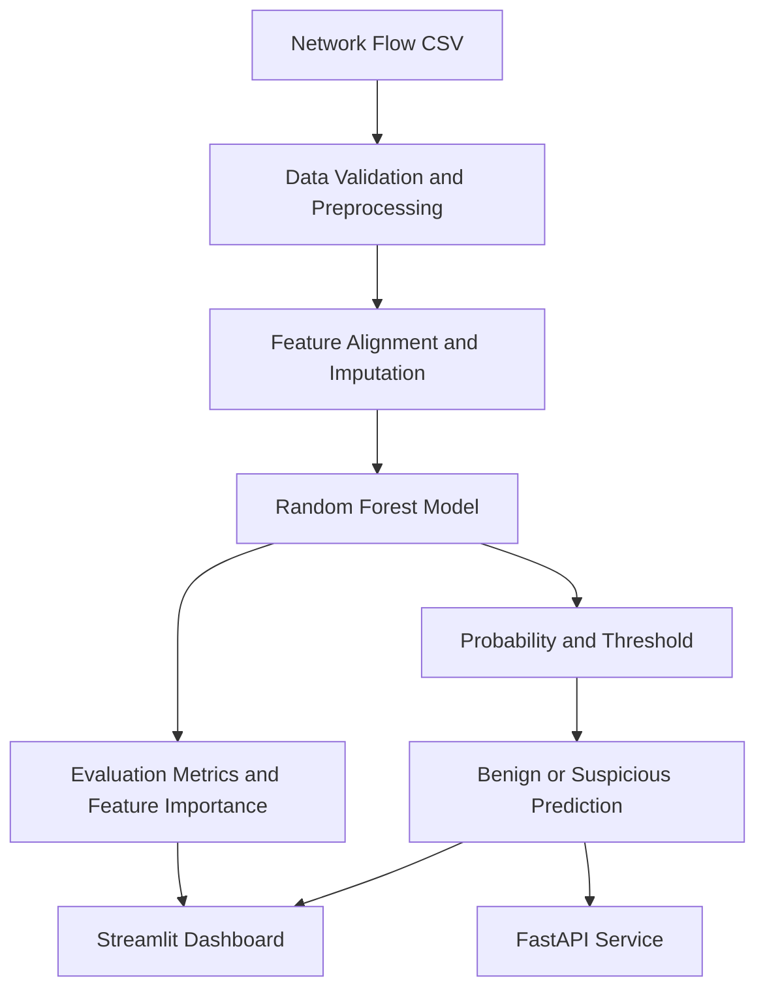

# SentinelAI Advanced — AI-Powered Network Intrusion Detection

SentinelAI Advanced is a cybersecurity portfolio project that uses machine learning to classify network-flow records as **Benign** or **Suspicious**. It combines a Random Forest classification pipeline with an interactive Streamlit dashboard, a FastAPI inference service, model evaluation, and automated tests.

The project demonstrates an end-to-end ML workflow: data preparation, model training, threshold-based classification, evaluation, API development, and batch predictions.

> **Research disclaimer:** The reported CIC-IDS2017 results are an exploratory benchmark, not proof of production readiness. The Wednesday benchmark was inspected during earlier development and threshold diagnostics, so it should not be considered a pristine, untouched test set. Independent validation on a new capture or dataset is required before making real-world performance claims.

## Features

- Network-flow classification using a Scikit-learn Random Forest pipeline
- Data preprocessing and numeric feature alignment
- Configurable decision threshold
- Accuracy, balanced accuracy, precision, recall, F1-score, and confusion matrix
- Feature-importance visualization
- Streamlit dashboard with model information and batch CSV predictions
- Downloadable batch prediction results
- FastAPI endpoints for health checks, model information, and inference
- Automated tests and GitHub Actions CI
- Docker support for local API deployment

## Architecture



## Technology stack

| Area | Technologies |
|---|---|
| Language | Python |
| Machine learning | Scikit-learn, Random Forest |
| Data processing | Pandas, NumPy |
| Dashboard | Streamlit |
| API | FastAPI, Uvicorn |
| Testing | Pytest |
| Deployment | Docker |
| CI | GitHub Actions |

## Benchmark results

The current candidate model was trained using selected CIC-IDS2017 days, with Friday used for threshold selection and Wednesday used for exploratory evaluation.

**Wednesday exploratory benchmark**

| Metric | Result |
|---|---:|
| Accuracy | 82.27% |
| Balanced accuracy | 74.12% |
| Suspicious-class precision | 87.06% |
| Suspicious-class recall | 51.81% |
| Suspicious-class F1-score | 64.96% |
| Decision threshold | 0.01 |

**Confusion matrix**

Rows represent actual labels; columns represent predicted labels.

| | Predicted Benign | Predicted Suspicious |
|---|---:|---:|
| Actual Benign | 402,115 | 14,920 |
| Actual Suspicious | 93,371 | 100,388 |

The model identifies some suspicious traffic but misses a substantial number of suspicious records. A high precision score does not eliminate the risk of false negatives.

These figures describe this particular exploratory benchmark only. They do not establish generalization to new networks, new attacks, or live traffic. Results should be revalidated on an independent capture with a documented evaluation protocol.

## Project structure

```text
SentinelAI-Advanced/
├── api/
│   └── main.py
├── src/
│   ├── data.py
│   ├── model.py
│   ├── inference.py
│   ├── train.py
│   ├── evaluate_multiday.py
│   ├── evaluate_cross_day.py
│   ├── evaluate_validated_threshold.py
│   ├── diagnose_thresholds.py
│   └── refresh_candidate_evaluation.py
├── tests/
│   ├── test_api.py
│   └── test_core.py
├── artifacts/
├── data/
├── app.py
├── requirements.txt
├── Dockerfile
└── .github/workflows/ci.yml
```

Datasets and trained model artifacts are intentionally excluded from Git.

## Setup — Windows PowerShell

### 1. Clone the repository

```powershell
git clone https://github.com/YOUR_USERNAME/SentinelAI-Advanced.git
cd SentinelAI-Advanced
```

### 2. Create a virtual environment

Use Python 3.11 or 3.12 if supported by the pinned dependencies.

```powershell
python -m venv .venv
.\.venv\Scripts\Activate.ps1
python -m pip install --upgrade pip
python -m pip install -r requirements.txt
```

If PowerShell blocks activation, run the following in the current terminal:

```powershell
Set-ExecutionPolicy -Scope Process -ExecutionPolicy Bypass
.\.venv\Scripts\Activate.ps1
```

### 3. Prepare model artifacts

The trained model and metadata are not included in the repository. You must generate them locally before using the dashboard or inference service.

To train the demo model:

```powershell
python -m src.train
```

The application expects the model and metadata in `artifacts/`.

For CIC-IDS2017 experiments, download the dataset from the [Canadian Institute for Cybersecurity](https://www.unb.ca/cic/datasets/ids-2017.html), review its terms, and place the required CSV files in the expected local data directory. Follow the project's training and evaluation scripts for the chosen experiment.

Do not assume the demo model reproduces the reported CIC-IDS2017 benchmark. Recreate the documented experiment and validate the resulting metrics before reporting them.

### 4. Run the dashboard

```powershell
python -m streamlit run app.py
```

Open the local URL printed by Streamlit, typically `http://localhost:8501`.

### 5. Run the API

Open another terminal, activate the same virtual environment, and run:

```powershell
python -m uvicorn api.main:app --reload --host 127.0.0.1 --port 8000
```

API endpoints:

- Health check: `http://127.0.0.1:8000/health`
- Model information: `http://127.0.0.1:8000/model`
- Interactive API documentation: `http://127.0.0.1:8000/docs`

### 6. Select the candidate artifacts

If you have generated the candidate model and its metadata under `artifacts/candidate/`, select them before starting the dashboard or API:

```powershell
$env:SENTINELAI_ARTIFACT_DIR = "artifacts\candidate"
python -m streamlit run app.py
```

For the API, use the same environment variable in its own terminal before starting Uvicorn. The variable applies only to the current PowerShell session.

### 7. Run the tests

```powershell
python -m pytest -q
```

The current development run completed with **8 passed**. Test results may change as the project evolves; run the suite again on the version you publish.

## Batch predictions

The dashboard accepts a CSV containing compatible numeric network-flow features. It displays the number of records, predicted suspicious records, benign records, suspicious percentage, and detailed model outputs. Results can be exported as a CSV.

A prediction of `Benign` does not prove that a flow is safe. Predictions depend on training data, feature compatibility, model quality, and the selected threshold.

## Security and limitations

- This project classifies supplied flow records; it does not capture packets or automatically block traffic.
- Predictions are triage signals, not proof of an incident.
- False positives and false negatives are expected.
- Feature importance indicates model reliance, not causation.
- Evaluation can be affected by data leakage, duplicate records, dataset bias, and distribution shifts.
- The current Wednesday benchmark is exploratory because that data was inspected during development.
- Validate on independent captures before considering operational use.
- Analyze only systems and data you own or are authorized to inspect.

## Future improvements

- Validate against a genuinely independent dataset or network capture.
- Add time-aware and capture-aware evaluation.
- Improve recall while measuring the resulting false-positive trade-off.
- Add drift monitoring and experiment tracking.
- Add authentication, rate limiting, and deployment hardening before exposing the API.
- Publish reproducible dataset preparation and model-training instructions.

## Resume project description

**SentinelAI Advanced — AI-Powered Network Intrusion Detection:** Developed a machine-learning network-flow classification platform using Python, Scikit-learn, Random Forest, Streamlit, and FastAPI. Implemented threshold-based inference, confusion-matrix evaluation, feature-importance visualization, batch CSV prediction exports, REST API endpoints, Docker support, and automated testing. Evaluated a candidate model on CIC-IDS2017 and documented the limitations of the exploratory benchmark.

## License

Add a license if you intend to specify how others may reuse the code. Dataset terms and redistribution rights remain separate from the project's code license.
